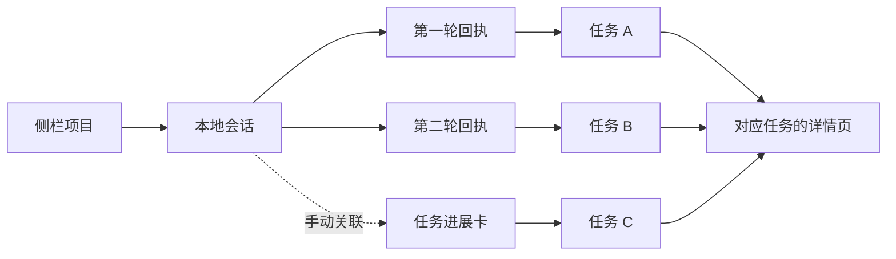

# GongYuAI 前端逻辑快照

2026-11-23 · 本机工作区 `apps/console` · 基于 `main@c1d95e2` 及未提交文件。对照本机已记录的 `origin/main@f0e80d2`，本地分支落后 12 个提交，两边的控制台文件有 25 个路径内容或存在性不同。本文描述当前目录能构建出的界面。核验方式见第八节。

## 一、先看用户面对的三个对象

| 对象 | 怎么产生 | 用户在哪里看到 | 谁保存 |
| --- | --- | --- | --- |
| 项目 | 首次打开时提供默认项目 GongYuAI，也可在侧栏新建 | 侧栏分组、会话顶部路径、会话详情 | 当前浏览器。项目给会话分组，任务列表和总览仍展示整个控制面的数据 |
| 会话与轮次 | 新建会话分配会话 ID。第一次提交产生第一轮，后续提交继续追加 | 侧栏历史、中央对话、右侧轮次目录 | 浏览器按轮次保存，按会话 ID 聚合。首问压缩空白后取前 48 个字符作为标题，侧栏按最近一轮的创建时间倒序排列 |
| 服务端任务 | 会话提交一轮材料产生一份任务回执，也可以在「任务」页通过表单创建 | 轮次回执、关联任务进展卡、任务列表、任务详情 | 控制面保存任务、运行状态、证据和报告。前端在浏览器内保存轮次与任务的对应关系 |

**一个会话可以包含多张任务回执，也可以另外关联一个任务。** 例如，提交两轮会议材料，可以分别得到任务 A、B。随后在「会话详情」关联任务 C，界面会多出 C 的进展卡。点击第一轮回执打开 A，点击进展卡打开 C，下一轮提交仍会产生自己的回执。这个区别决定了「会话状态」「任务进展」和「任务结果」分别说的是谁。[会话状态](../apps/console/src/chat/useConversations.ts) · [项目与关联关系](../apps/console/src/chat/useChatProjects.ts) · [会话页面](../apps/console/src/pages/ChatPage.tsx)

## 二、页面与导航

前端使用 React、TypeScript、Vite 和 Semi Design。根组件解析 URL 的 hash，并在切换时更新它，浏览器前进、后退和直接粘贴链接都走同一个入口。会话页随首页加载，其余四个页面组件按需加载。开发时 Vite 代理 API，发布构建由控制面提供首页和静态资源。[应用入口](../apps/console/src/main.tsx) · [导航与外壳](../apps/console/src/App.tsx) · [路由表](../apps/console/src/labels.ts) · [构建配置](../apps/console/vite.config.ts)

| 入口 | 地址或触发位置 | 进入后的行为 |
| --- | --- | --- |
| 会话首页、已有会话 | `#/chat`、`#/chat/<会话ID>` | 有本地轮次时显示历史和底部输入框，其余情况显示欢迎页和居中输入框。空地址或未知路由回到会话 |
| 项目与会话侧栏 | 应用左侧 | 新建项目、新建会话、展开分组、按项目名或会话标题搜索。命中项目名时展示组内全部会话。窗口宽度 ≤760 px 时通过左侧抽屉打开历史 |
| 设置与功能 | 侧栏左下角 | 打开抽屉，按工作区、任务详情、系统设置分组。选中入口后关闭抽屉，并更新地址 |
| 工作区 | `#/overview`、`#/tasks` | 总览和任务列表点击任务行均进入该任务的「运行态」 |
| 任务详情 | `#/<详情页签>/<任务ID>` | 八个页签共享一个详情组件。未带 ID 时依次使用上次任务、任务列表最后一项。显式指定的 ID 查不到会显示「未选择任务」 |
| 系统设置 | `#/settings-<分区>` | 八个分区共用设置页。模型配置允许额外带服务商 ID，直接打开该配置 |
| 返回会话 | 非会话页左上角 | 回到本次打开应用以来最后访问的会话。带命令审批记录的任务另有专用链接，打开 `#/chat/task-<任务ID>`，自动展示该任务的进展 |

旧链接 `#/settings` 和 `#/settings-tools` 进入模型配置，`#/dive/<任务ID>` 进入运行态。会话右侧详情、模型菜单、审批说明和任务创建表单都是页面内的弹层，各自没有独立路由。

## 三、会话从输入到结果

1. **开始或切换会话。** 新建项目会同时打开该项目的空会话。项目名必填、最多 80 个字符，并检查完全相同的名称。空会话在当前项目显示临时占位，首轮保存后才进入历史列表。切换会话会保留仍在本次打开期间的文字和附件草稿。
2. **选择模型。** 应用在路由类型变化时读取模型目录。优先使用本会话刚选的配置，其次取最后一轮保存的选择。配置无效时回到默认服务商的主模型。模型按钮或单独输入 `/model` 并提交可打开选择器。只展示该协议与模型支持的思考强度。换模型时重置单次强度。目录首次加载失败且无可用选择时，提交按钮禁用。
3. **准备材料。** 输入框上限 32,000 字符。Enter 提交，Shift+Enter 换行，中文输入法选词期间不会误发。支持 UTF-8 文本、PNG、JPEG、WebP，每轮最多 4 件、合计 2 MiB，单个文本上限 128 KiB、图片 1 MiB。可以只发附件，此时自动补上「请查看附件。」附件读取和保存期间禁用提交。
4. **提交本轮。** 先把附件正文写入 IndexedDB，再保存本轮问题、所选模型和附件引用。同会话在提交请求返回前拦截重复提交。请求上下文由此前已有结果且无错误的问答，以及本轮问题和附件组成。没有结果的轮次会跳过。发出后清理本次送出的草稿，回执返回后便可再发一轮，前一项任务可能仍在处理。
5. **等待和回看。** 当前会话每一轮各自显示回执。先返回任务编号和状态，后续由回执卡查询并回写；取得结果后显示「任务结果」。用户在底部附近时随最后一轮更新自动下滚，向上阅读时保留位置。旧的普通问答记录仍支持显示原回答、审批摘要和中断提示。
6. **失败与恢复。** 有任务 ID 时按任务查回执，只留下提交 ID 时按提交记录找回。服务器没有该提交时可重新提交。重试沿用原轮次和提交 ID，附带当前选中的模型；服务端对相同 ID 和相同内容返回已有任务，内容发生变化时可能报冲突。附件从浏览器丢失也会影响重试以及需要引用它的后续轮次。
7. **查看或关联任务。** 右上「会话详情」显示项目、关联任务、模型、思考强度、最后一轮状态和轮次目录。点目录项关闭抽屉并定位原文。选任务时才加载候选列表。手动关联的进展卡固定在关联时的最后一轮，找不到该轮时放在第一轮，空会话放在欢迎区。卡中展示目标进度、最多四项计划、最近有记录的调整原因和审批记录，可跳到完整任务详情。

输入区的「审批」打开当前策略说明，并可进入审批设置。任务受阻原因可出现在回执里，关联任务进展卡还会读取任务级审批记录。图片任务可能由配置的视觉模型处理，轮次目录会记录实际返回的模型。[输入与展示](../apps/console/src/pages/ChatPage.tsx) · [文件处理](../apps/console/src/chat/attachments.ts) · [提交与回写](../apps/console/src/chat/useConversations.ts) · [任务回执](../apps/console/src/components/AssignmentCard.tsx) · [关联任务](../apps/console/src/components/ChatTaskProgress.tsx)

## 四、总览、任务列表与详情

**总览**显示进行中、已完成、恢复中、全部任务，统计只包括未归档任务。最近任务最多八条，按创建时间倒序。**任务列表**提供「进行中」「已归档」两个视图，实际以是否存在归档时间筛选。所以一个已完成但尚未归档的任务仍出现在「进行中」。任务表按创建时间倒序，超过 12 条分页。已完成且没有目标或仍有目标未通过的任务显示「目标待核对」。[总览](../apps/console/src/pages/OverviewPage.tsx) · [任务列表](../apps/console/src/pages/TasksPage.tsx) · [任务表](../apps/console/src/components/TaskTable.tsx)

**表单创建**位于任务列表的「新建任务」抽屉。用户填写任务范围、授权依据、目标、可选排除项和并发数。界面校验必填项与授权依据长度，多行目标分别形成目标项。提交成功后关闭抽屉，进入新任务的运行态并刷新列表。此入口创建并启动任务，界面不会自动为它创建侧栏会话。

**详情页头**显示任务名、状态、短编号、范围版本、外部状态及最后确认时间（如有）。运行中的常规状态提供暂停和停止，进入暂停或停止收尾后仅保留停止。已暂停时提供继续，结束类状态提供开始。终态可归档，已归档可取消归档。归档是独立标记，动作按钮仍按运行状态判断。详情八个页签如下。[详情控制器](../apps/console/src/pages/TaskDetailPage.tsx) · [状态分类](../apps/console/src/labels.ts)

| 页签与路由键 | 读取和展示 | 用户操作及结果 |
| --- | --- | --- |
| 运行态 `live` | 历史和运行快照。展示阶段、租约、检查点、预算用量、节点状态、Skill/MCP 用量、人工提示和执行时间线 | 展开步骤、按需读取调用明细、加载更早步骤。可提交人工提示，成功后立即加入本页提示列表 |
| 资产 `assets` | 资产清单，按种子、候选、准入、存活、范围外计数，并列出地址、来源、说明和关联事实 | 浏览、分页。详情页展示当前任务已记录的资产，系统设置中的「资产收集」管理数据源 |
| 目标 `goals` | 目标契约、证据路径、核算条件、历史判定、人工覆盖、开放意图、近期事实、关系图 | 可登记人工覆盖结论、复核人、依据与证据路径。保存后回显，可下载复核时留存的证据 |
| 漏洞 `findings` | 从历史读取发现台账，显示严重性、状态、资产、端点、证据数和记录时间。严重性小计排除撤回项，明细保留它们 | 展开查看既有记录的影响、修复建议等，点击封存证据读取正文。当前页面为只读 |
| 历史 `history` | 历史摘要、意图、分层事实，与目标页共享事实–意图关系图 | 点节点查看详情和相邻连线，支持缩放、适应画布。画布宽度小于 560 px 时改纵向布局 |
| 证据 `evidence` | 进入时取得文件名、大小等目录信息 | 单击左侧文件才读取正文，在右侧预览。文件读取失败时原位显示错误 |
| 报告 `report` | 交付摘要，有留存报告时拼接原文，以预格式化文本展示。独立读取交付记分卡和历史核算记录 | 记分卡分列历史通过、当前证据支持、人工覆盖。可填写两份现有材料路径和主键进行差异核算，查看差异、来源行及结果文件的 SHA-256 |
| 日志 `logs` | 读取该任务的日志文本 | 以纯文本查看，空内容显示「（空）」，活跃任务持续刷新 |

运行态时间线合并结构化步骤、进度记录和事实，按时间排序，并去除已有结构化步骤的日志镜像。关系图只画有来源或产出关系的记录和标题层事实，缺失的引用有占位。覆盖登记、交付记分卡和材料核算各自拥有表单或读数状态。[执行时间线](../apps/console/src/components/ExecutionTrace.tsx) · [关系图](../apps/console/src/components/dag/buildDagLayout.ts) · [覆盖登记](../apps/console/src/components/GoalCoverage.tsx) · [交付记分卡](../apps/console/src/components/DeliveryScorecard.tsx) · [差异核算](../apps/console/src/components/ReconcilePanel.tsx)

## 五、八个系统设置分区

切入设置分区会读取公共设置。模型目录由应用外壳另行管理，审批策略由审批组件单独读取，用量页还会读取统计。公共设置首次读取失败会弹出错误，主体仍停留在「加载设置…」。[设置页](../apps/console/src/pages/SettingsPage.tsx)

| 分区与路由键 | 用户可见逻辑 |
| --- | --- |
| 模型配置 `settings-model` | 选服务商或添加自定义服务。可选协议、地址、密钥、主模型和视觉模型，查询候选或手填标识，保存后可作为新任务默认。查询期间切换服务商会忽略迟到的旧结果。已有密钥只展示配置状态 |
| 命令审批 `settings-approval` | 选择审批模型与范围，或沿用默认服务商的主模型。保存后显示结果，读取失败可重试 |
| 资产收集 `settings-assets` | 管理内置来源和自定义来源。内置项支持设置连接信息和启停，自定义项可添加、启停和删除。任务资产清单在任务详情查看 |
| MCP `settings-mcp` | 查看连接器及来源、切换启用状态、重新扫描目录、添加自定义连接器、删除用户项 |
| Skill `settings-skills` | 查看技能包及来源、切换启用状态、重新扫描目录、导入技能文本、删除用户项 |
| 用量统计 `settings-usage` | 查看总 Token、调用和安装次数、分任务数据、Skill/MCP 汇总和明细，可手动刷新。成功率分母只统计已有成功或失败结果的调用，待定单列 |
| 一键更新 `settings-update` | 显示当前版本、上次更新和来源。可单独保存来源。点击更新会先保存表内来源再发起更新，显示阶段和进度；更新完成后重载页面，已是最新时只刷新设置，失败时显示错误 |
| 运行时 `settings-runtime` | 信息页。显示当前浏览器访问的主机与端口，以及控制台能力说明。页面没有独立的服务端监听配置读数 |

模型选择器按会话保存当前选择，后续提交会沿用它。设置页保存的默认服务商影响采用默认值的会话。用量统计既可汇总整个系统，也可在单个任务的运行态查看。[模型选择](../apps/console/src/components/ChatModelPicker.tsx) · [服务商表单](../apps/console/src/components/ChatModelSettings.tsx) · [审批表单](../apps/console/src/components/ChatApprovalSettings.tsx) · [用量组件](../apps/console/src/components/IntegrationUsage.tsx)

## 六、状态归属、请求与刷新

| 数据 | 实际存放位置 | 刷新浏览器后的表现 |
| --- | --- | --- |
| 当前页面与显式会话、任务 ID | URL hash | 可恢复位置。打开另一个浏览器能定位同一服务端任务，会话正文则依赖该浏览器已有的轮次 |
| 已提交问题、结果、错误、轮次模型、任务 ID、附件引用 | localStorage，按轮次独立写入 | 重新聚合出会话树。监听同源其他标签页的变更。保存失败会提示，本次打开期间仍可显示 |
| 项目名、归属、折叠、手动关联及轮次锚点 | localStorage 的工作区记录 | 恢复本浏览器的组织结构，支持同源跨标签页更新 |
| 已提交附件正文 | IndexedDB，按附件 ID 保存 | 重试或构造下一轮历史时读取。服务端已有任务结果与本地附件副本有各自的生命周期 |
| 文字与待发附件草稿、尚未提交的模型选择、最近访问指针、抽屉与筛选 | React 状态或 ref | 重新加载会重置。文字与待发附件按会话 ID 放在应用外壳，当前应用内换页可以保留 |
| 任务台账、运行状态、历史、资产、证据、报告、用量、系统配置 | 控制面接口；页面持有最近一次返回值 | 按当前页重新读取。大部分请求集中在 API 模块，会话提交和回执控制另有直接使用 fetch 的入口 |

| 读取位置 | 触发与频率 | 用户会观察到什么 |
| --- | --- | --- |
| 非会话页外壳 | 进入时并行读任务列表、总览，每 4 秒重复 | 两个请求均成功后更新数据并显示在线，任一失败显示离线并保留旧数据。该指示反映这两项请求 |
| 活跃任务详情 | 任务 ID、状态或页签变化时首读。运行态、目标、历史、漏洞、资产、日志另有 2.5 秒轮询 | 每次详情轮询成功还会刷新外壳。证据和报告正文没有这个定时器。详情页头的「刷新」直接调用外壳刷新 |
| 会话单轮回执 | 挂载或提交完成时查询。排队、初始化、运行中约 1 秒；暂停、失败、已停止约 12 秒；一般读取错误约 3 秒 | 结果回写本地轮次。未找到提交记录时等待人工重试。离开会话卸载回执卡，返回时重新查询 |
| 手动关联的进展卡 | 并行读取任务、历史、运行态。活跃约 12 秒、非活跃约 60 秒，页面隐藏时暂停 | 失败后保留上次快照并提示重试。回到可见状态会再次读取。与单轮回执独立计时 |
| 系统更新 | 发起更新后每 1.5 秒读取进度 | 服务重启引起的断线会继续尝试。持续断线超过 180 秒提示超时。完成后可能重新加载整页 |

会话主路径使用 HTTP 请求和轮询。模型的最终结果在回执中返回，文本以普通文本展示。任务详情及统计常用北京时间格式化，聊天时间使用浏览器本地时区。[请求封装](../apps/console/src/api.ts) · [会话传输](../apps/console/src/chat/transport.ts) · [回执轮询](../apps/console/src/components/AssignmentCard.tsx) · [时间格式](../apps/console/src/time.ts)

## 七、改造前值得对齐的现有行为

| 位置 | 当前行为及影响 | 核验依据 |
| --- | --- | --- |
| 总览最近任务 | 共用任务表会给符合条件的行渲染「归档」。总览只传了选行回调，按钮会截住行点击，也没有归档回调，因此看得到按钮但点击无动作 | 总览页、任务表 |
| 任务列表「进行中」 | 筛选条件是未归档。总览「进行中」统计活跃任务，两个同名入口可能给出不同数量 | 任务列表与总览接口 |
| 详情「刷新」 | 只重新获取任务列表和总览。同一任务、状态和页签下，证据目录、报告正文和记分卡不会因这次点击重读。报告核算成功会更新核算区，但不保证同时更新其他报告区块 | 详情页、记分卡、核算组件 |
| 证据预览 | 连续选择 A、B 后，如果 A 的响应更晚，它能覆盖正文，而高亮仍停在 B。读者可能把 A 的内容归给 B | 证据页选中路径与正文回调 |
| 当前任务与当前会话 | 从功能抽屉直接进详情可能使用上次任务或最新创建的任务，甚至是归档任务。从详情打开任务审批会话会生成按任务 ID 寻址的视图，原来的材料对话仍由原会话 ID 寻址 | 根组件的详情 ID 与会话 ID 选择规则 |
| 状态与审批显示 | 会话详情的「会话状态」只取最后一轮。回执卡与详情页的状态映射及可见动作也有差异。回执上的错误原因、旧轮次的审批摘要和关联卡上的任务审批详情来自不同字段 | 会话页、回执卡、关联卡、状态表 |
| 首次读取、断线与空数据 | 总览首读前用 0 占位，任务列表初始为空。某些详情首次加载失败会弹错，定时刷新失败则静默。读者可能同时看到旧内容和外壳的离线指示 | 根组件、总览、详情页 |

目前可直接导航的图包含目标和历史页共用的事实–意图关系图。设计文档中提到的独立多图工作区、记忆页等没有进入当前路由表。服务端或 API 封装里存在的方法，也只有在用户能从页面实际触发时，才计入上面的交互清单。[现有路由](../apps/console/src/labels.ts) · [历史设计说明](./console-research.md)

## 八、核验范围

前端 TypeScript 类型检查通过。把当前源码构建到独立临时目录成功，Vite 提示部分压缩后的代码块超过 500 kB。本机无头 Chrome 使用模拟数据逐一打开 19 个主路由，包含 1 个会话、2 个工作区、8 个任务页签和 8 个设置分区。另检查了历史兼容链接、未知路由回退、390 px 宽度的会话抽屉、会话详情任务选择、发送一条模拟材料、刷新恢复轮次，以及回执与手动关联的独立性。

在已完成的模拟任务中，点击详情页头「刷新」后，证据目录请求次数没有增加。随后连续点选两个文件，并让第一个请求延迟返回，复现了第二项高亮但显示第一项正文。以上核验使用隔离页面和模拟接口，未调用真实模型、执行实际任务或验证部署环境。
